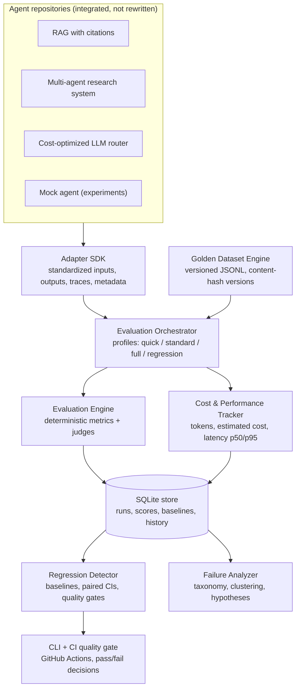

# Architecture

## 1. Overview

One reusable evaluation platform, many agents. An agent is integrated
by writing a thin adapter against the common contract — the evaluation
engine never learns which framework the agent uses internally.

## 2. Components

| Component | Code | Responsibility |
|---|---|---|
| Adapter SDK | `eval_platform/adapter.py` | The contract, error normalization (timeout/infra/contract), registry |
| Adapters | `eval_platform/adapters/` | One thin wrapper per agent + the deterministic MockAdapter |
| Golden Dataset Engine | `eval_platform/datasets.py`, `datasets/` | JSONL datasets, validation, `name@sha8` content-hash versions |
| Evaluation Engine | `eval_platform/metrics/`, `eval_platform/judges.py` | Deterministic metrics, project-specific metrics, judge interface |
| Orchestrator | `eval_platform/orchestrator.py` | Profiles, timeout-guarded execution, aggregation, partial-failure handling |
| Store | `eval_platform/store.py` | SQLite persistence with reproducibility metadata |
| Regression Detector | `eval_platform/regression.py` | Baseline comparison, paired 95% CIs (normal approx), quality gates, PASS/FAIL/INCONCLUSIVE |
| Failure Analyzer | `eval_platform/failures.py` | Failure taxonomy, clustering, root-cause hypotheses, failure → draft golden case |
| API (optional) | `eval_platform/api.py` | FastAPI layer, lazily imported |
| CLI / CI scripts | `eval_platform/__main__.py`, `scripts/` | Local runs, reports, CI quality gate |

## 3. Honest scoping — what v1 is and is not

The roadmap's production deployment (PostgreSQL, Celery + Redis
workers, Next.js dashboard, cloud hosting) is a **deployment step, not
the v1 core**. What is built here:

- **SQLite instead of PostgreSQL**, with the schema mirrored
  table-for-table (agents, agent_versions, datasets, dataset_versions,
  test_cases, evaluation_runs, test_results, metric_results, baselines,
  regressions, failure_clusters, quality_gates, judge_versions,
  human_feedback, audit_events). Moving to Postgres is a connection
  change, not a redesign.
- **Synchronous orchestration with per-case timeout guards** instead
  of Celery/Redis queues. Profiles and idempotent run records are in
  place; a queue can sit behind the same orchestrator interface.
- **Deterministic + lexical judges offline.** The LLM-as-a-judge slot
  exists (`judges.LLMJudge`) and reports itself *infrastructure
  unavailable* without an API key — it never fabricates a score.
- **No dashboard yet.** The roadmap order is deliberate: pipeline
  first (CLI/API), dashboard around real results later. All data the
  dashboard will need is already in the store and the trends endpoint.

## 4. The infra/quality separation

The platform's central design rule: **infrastructure problems are not
quality failures.** An unavailable agent, a missing API key, or a
timed-out call is recorded as an infra error, excluded from quality
scores, and — if frequent in a compared run — forces the regression
decision to INCONCLUSIVE rather than FAIL.
